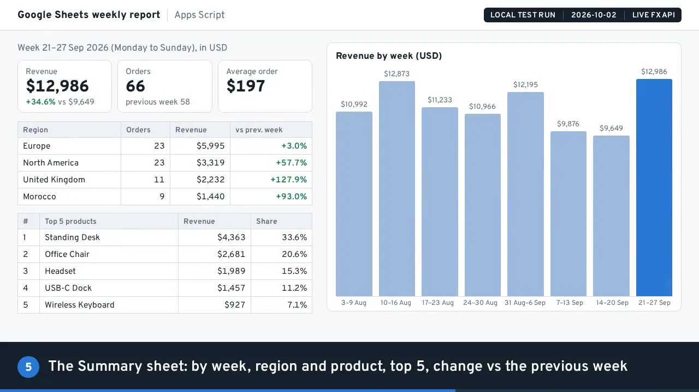
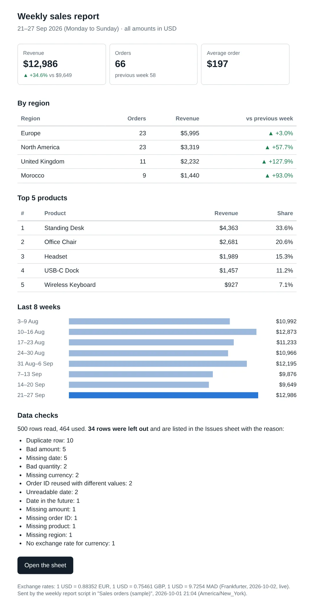

# Google Sheets one-click weekly report (Apps Script)

Demo on synthetic orders: 500 raw orders in, 464 clean, 34 bad rows listed with the reason, USD at live exchange rates, summary, chart and email. 31 of 31 tests pass.

Demo page with a recorded replay: https://slimanechanchoul.com/sheets-report/

Demo on sample data: every order in `sample-data/` is synthetic. The numbers below come from a run of these Apps Script files in a Node harness with stand-ins for the Google services, against the live exchange-rate API.

Tests: `npm test` (or `node --test tests/*.test.js`)



## What the one-click report does

One menu click, **Reports > Run weekly report**, and a Google Sheet of raw orders becomes:

- **Clean data**: valid orders, trimmed and de-duplicated, with dates parsed and amounts in USD.
- **Issues**: every row left out, with the reason and the original values.
- **Summary**: totals by week (last 8), region and product, top 5 products, change vs the previous week, and a chart.
- **Email** to the owner (HTML with inline styles plus plain text, address from the Settings tab), and an **error email** if a run fails. Not yet checked in real mail apps.
- **Run log**: one row per run.

Exchange rates come live from the free [Frankfurter](https://frankfurter.dev) API (no key). The script uses its v2 endpoint because the older `api.frankfurter.app` endpoint has no MAD. Rates are cached for 6 hours. If the API is down, the last good rates (up to 7 days old) are used and the email says so. With no usable rates the run stops before changing any sheet. **Reports > Install weekly trigger** runs it every Monday between 7 and 8 am.

The script asks for 5 narrow OAuth scopes only (this spreadsheet, the menu, one external request, send mail, the trigger).

## The numbers (local harness run, synthetic orders)

Sample: `sample-data/orders.csv`, 500 synthetic rows (3 Aug to 27 Sep 2026; USD, EUR, GBP, MAD) with planted problems, loaded as text, like a Sheets CSV import with "Convert text to numbers, dates, and formulas" unticked (see INSTALL.md). A test shows a US-locale import with that box ticked would swap day and month in 5 rows.

| | |
|---|---|
| Rows read / used / left out / blank lines | 500 / 464 / 34 / 2 |
| Left out: duplicates, reused IDs | 10, 2 |
| Report week | 21–27 Sep 2026 |
| Revenue, change vs previous week | $12,986 (+34.6% vs $9,649) |
| Orders, average order | 66, $197 |
| Rates used (2026-10-02) | 1 USD = 0.88352 EUR, 0.75461 GBP, 9.7254 MAD |
| Second run (as the trigger calls it) | rates from the cache, no new HTTP request |
| Simulated outage (API down, no saved rates) | run FAILED, no output sheet written, error email |
| Tests | 31 of 31 pass (`outputs/test-results.txt`) |

The email the harness captured (not sent) for that week:



## How the numbers were measured

- The same 8 `.gs` files in `apps-script/` are loaded into Node by `harness/load-gas.js`. `harness/gas-mocks.js` provides stand-ins for SpreadsheetApp, MailApp, Utilities, CacheService, PropertiesService, LockService, ScriptApp and Charts. UrlFetchApp does a real HTTP request, so the rates are live.
- `harness/run-local.js` runs the report twice (menu, then as the weekly trigger would), then once more with the API made unreachable and no saved rates. It saves every tab as the script wrote it, the captured email and a summary to `outputs/`.
- The harness and the tests run the script as of **1 Oct 2026** in the sheet's time zone, so a re-run on any later day still reports 21–27 Sep 2026 and finds the same 464 / 34 rows. The USD amounts follow the live rates of the day you run it.
- This is not a run inside Google Sheets. It has not been installed in a real Google Sheet yet; [INSTALL.md](INSTALL.md) has the steps to do that.

## Install in your own Google Sheet

Step by step in [INSTALL.md](INSTALL.md): the Orders tab and its headers, pasting the 8 script files and the manifest, the first authorization, the owner email, the weekly trigger, and what to check when a run fails.

## Run the Node harness

```bash
node sample-data/make-orders.js     # rebuilds sample-data/orders.csv (seeded, same file every time)
node harness/run-local.js           # real run, writes outputs/ (needs internet for the rates)
npm test                            # 31 tests; 5 of them call the live rate API, so they need internet
```

No npm packages are needed (Node 20+).

## Layout

```
apps-script/   the Apps Script project: 8 .gs files + appsscript.json (5 narrow OAuth scopes)
harness/       gas-mocks.js (stand-ins for the Google services), load-gas.js, run-local.js
tests/         node:test suite (31 tests)
sample-data/   make-orders.js (seeded) -> orders.csv, synthetic orders
outputs/       saved results of the last harness run (synthetic data)
docs/          screenshots of that run
```

## Licence

MIT, see [LICENSE](LICENSE).

## Need this for your business?

Your own order sheet and columns, other currencies, sources or report layouts, and a schedule that fits your week. I build these tools. https://www.upwork.com/freelancers/~01d6ae0f1a06a43ac0
